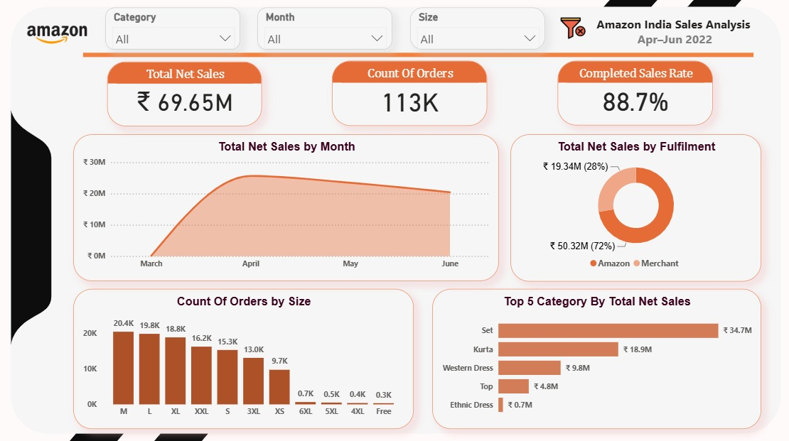
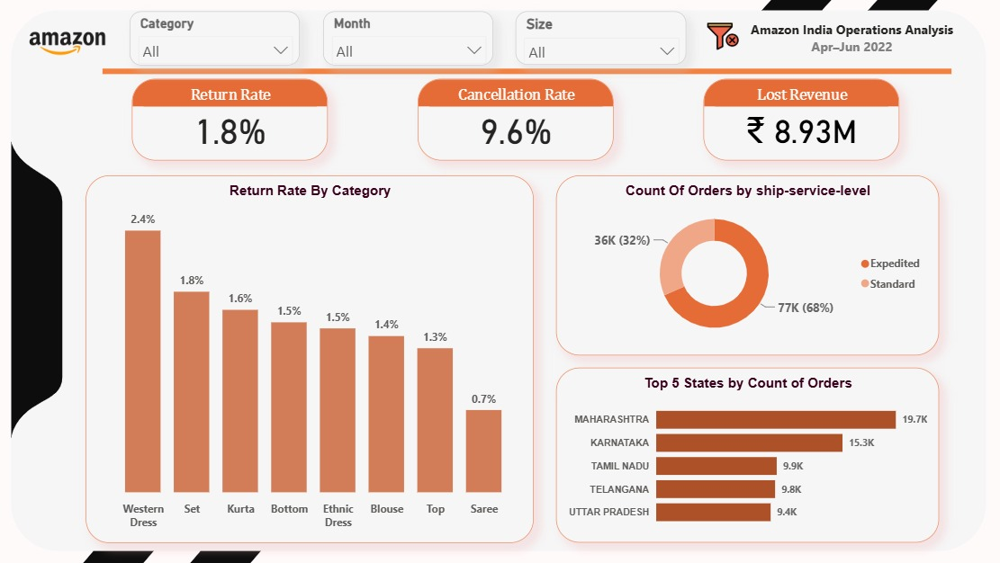

# Amazon India Sales Analysis | Power BI

A 2-page interactive Power BI dashboard analyzing Amazon India e-commerce
sales (Apr–Jun 2022). This is a practice project built on a course dataset
and is not affiliated with Amazon.

## Dashboard Preview

## Business Questions
- How much revenue was generated, and which categories, sizes and fulfilment types drive it?
- How much revenue is lost to unfulfilled and returned orders?
- Which shipping levels and states generate the most orders?

## Key Findings
- ₹69.65M in net sales (completed orders) from a total of 113K orders
- "Set" is the top category (₹34.7M), about half of net sales
- Amazon-fulfilled orders account for 72% of net sales
- 9.6% of orders were unfulfilled (cancelled or pending)
- ₹8.93M in potential revenue was lost to unfulfilled and returned orders
- Western Dress has the highest return rate (2.4%)
- Maharashtra (19.7K) and Karnataka (15.3K) lead in order volume

## KPI Definitions

| KPI | Definition |
|---|---|
| Total Gross Sales | Sum of Amount across all order statuses |
| Total Net Sales | Sum of Amount for orders with status "Completed Sale" only |
| Lost Revenue | Gross Sales − Net Sales: revenue from unfulfilled and returned orders |
| Count of Orders | Distinct count of Order ID |
| Completed Sales Rate | Completed orders ÷ total orders |
| Cancellation Rate | Unfulfilled orders (cancelled or pending) ÷ total orders |
| Return Rate | Returned orders ÷ total orders |

**Notes:**
- Percentages are rounded to 1 decimal place, so totals may differ by ±0.1%.
- The dataset starts on 31 March 2022, so March contains a single day of data and is not comparable to the full months.

## Data Preparation (Power Query)
- Selected the 17 relevant columns and removed the rest
- Created a conditional `Fulfillment Status` column grouping order statuses into Completed Sale, Returned and Unfulfilled
- Set data types and cleaned text (trim, remove non-printable characters, capitalization, proper case for Category and Courier Status)
- Replaced missing shipping values with "Unknown" and handled errors (dates to null, quantity and amount to 0)
- Removed duplicate rows and created a unique `Transaction ID` (Order ID + SKU)

**Status mapping:**
- Unfulfilled = Cancelled / Pending
- Returned = returned, rejected, damaged or lost shipments
- Completed Sale = everything else

## Tools
Power BI Desktop | Power Query | DAX

## Dataset
Amazon India sales dataset (Apr–Jun 2022), 
provided by the course instructor (Eng. Mahmoud Ayman, Data Analysis Diploma) for practice.

## Files
- `Amazon_Sales_Dashboard.pbix`
- `screenshots/`

## Author
Mariam Mohamed | [LinkedIn](https://www.linkedin.com/in/mariam-mohamed-306527224/)
